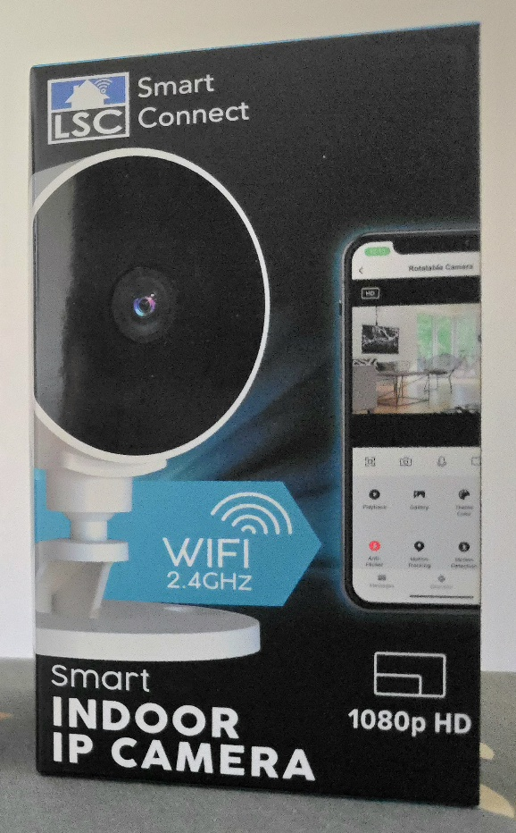
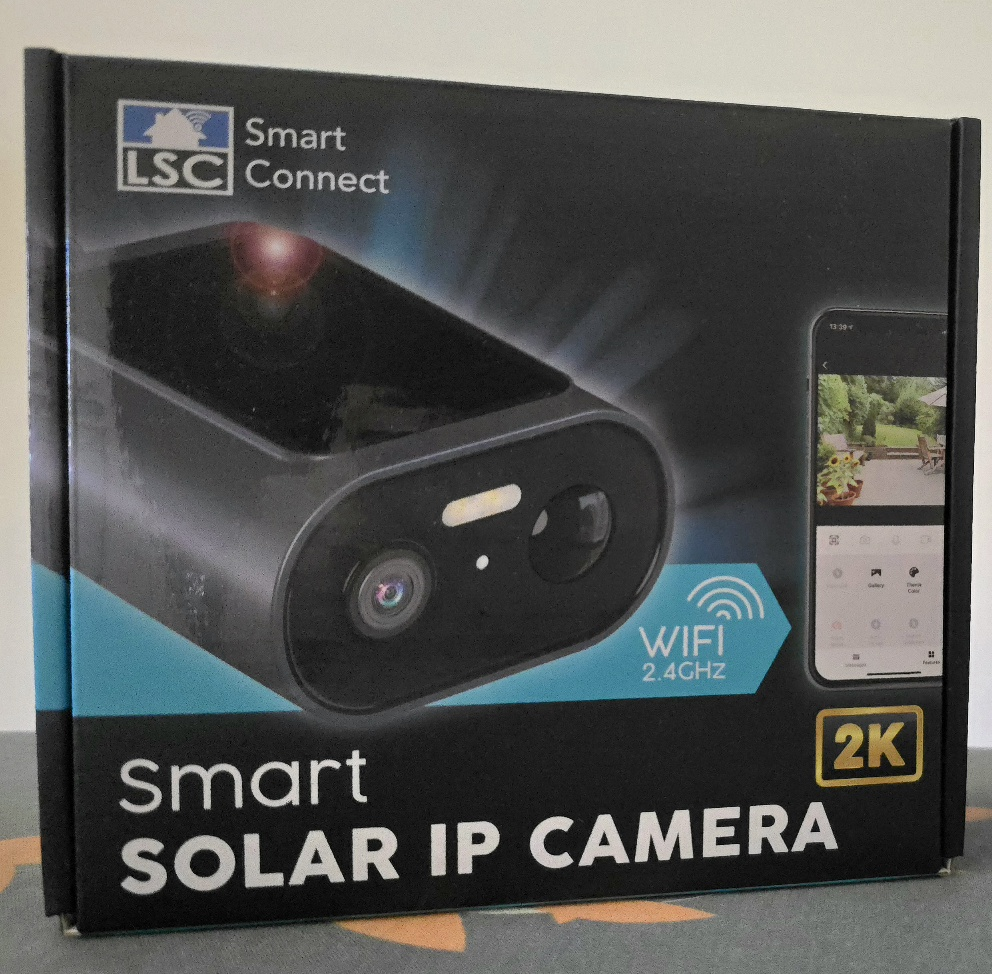

# LSC Camera Toolkit

This project is the condensation of the work from [tasarren](https://github.com/tasarren/lsc-tuya-toolkiot)
focused on enabling RTSP support on the LSC cameras that I own (cameras you get on Action stores).

Note: The steps here aren't doing anything risky to the camera BUT I'm not responsible if anything goes bad. Make sure you don't use a crappy card, a crappy reader, a crappy power plug/cable, don't have a crappy house electrical wiring and don't have a crappy crap.  **Do this at your own risk!**

The cameras are:
- LSC Indoor IP Camera 1080p - FW 6.2802.78 - Anyka AK39 chip family (aka LSC Smart Connect 1080p IP Indoor Mini)

- LSC Smart Solar Camera 3MP - FW 6.1.23 - Anyka AK39 chip family? (aka LSC Smart Solar Camera 2K / 3MP Gun metal) - **SUPPORT COMING SOON**, *hopefully*.

For more information on what follows here visit [tasarren page](https://github.com/tasarren/lsc-tuya-toolkiot).

**I would recommend starting with the Basic setup just to check if your model / firmware even supports these hacks.**

## What Changed
This is the list of changes compared to the original project:
- Updated the SW/HW settings files with the ones found in these firmwares
- Fixed some issues with the scripts
- Changed some of the default settings
- Added alternative ways to some settings that don't seem to work.
  - Disable LED light
  - Disable night vision
  - Remove timestamp
- Start scripts directly instead of relying on the Anyka IPC service
- Removed ONVIF scripts because in this firmware they don't work
- Removed everything related to PTZ since these cameras don't have it
- Removed unused files
- Cleaned up code that wasn't doing anything

## Notes
Before you go all crazy changing the HW/SW/anyka settings do keep in most of the time they won't work. The ones that seem to work more constantly are the HW ones. This is why there are hacks to do some of the stuff that should have been a toggle switch in these files. Maybe you get more lucky, maybe you figure out what's the problem and fix it, but me personally already lost countless hours trying to put the camera in the state I wanted and didn't explore more.

## What do you need
- The camera.
- microSD card.
- PC / smartphone / whatever with a card reader that you can use to write data to the microSD card.

## Enabling RTSP (Basic setup)
These steps enable RTSP on the camera with its default settings.
- Turn off the camera and remove its card if inserted.
- Copy `_ak39_factory.ini` from `sd_card` folder of this project to the card.
- Inside the file you need to enter your Wi-Fi and network information (name, password and more). Unfortunately without this the camera won't connect to your Wi-Fi even if you already set it up in the LSC/Tuya app. At least mine didn't.
  - If you don't know the gateway or any of the other paraments check the network information on your PC or smartphone.
    - Note: DHCP is not available when using this basic setup.
  - Don't forget that the IP address must be unique. Check your router's DHCP list or equivalent to know which ones are free.
  - This IP is important since it's the one you are going to use to connect to the camera with RTSP.
- Eject / unmount the card and put it in the camera.
- Turn on the camera (plug the cable).
- Wait for some woman speaking.
- Wait for a loud beep.
  - If you don't hear the beep after 1 minute it means the camera didn't connect to the Wi-Fi. Check if you made a mistake in the file from step 2.
- After the beep you can check the live stream with the URL: `rtsp://CAMERA_IP:554/main_ch` on VLC for example and you should see and hear something. Replace CAMERA_IP with the actual IP you set up.
- It's done! You now have the camera with RTSP working with its default settings.
- As a bonus, you also have telnet open on port 23. However, currently the default credentials are unknown. You'll have to go with the Advance Setup if you really want a working telnet.
 
## Advance Setup
By default, the camera uses night-mode, does that loud beep at start up, the blue LED is always blinking, etc.
We can tweak a few things.

To configure more advance settings, copy all the rest of the files in the sd_card directory to the card.

In **/configs/hack.conf** you can toggle the hacks.

During boot the hacks are applied (check [lsc tuya project](https://github.com/tasarren/lsc-tuya-toolkiot) for more info) or read the scripts.

The login for telnet now is `root / telnet`.

## FAQ
- Do I need to add the cameras to the LSC/Tuya app first? No but I would recommend to pair it just to see if the cameras are working. 
- Do the cameras need access to the Internet to work? No.
- How do I invert the image? In *sensor_inv* in the `_ht_hw_settings.ini`.
- In the Advance Setup can I use the `wifi.conf` to set up the Wi-Fi so that I have DHCP instead of manually in the ak39 file? Probably, I didn't test it.
- What's the aging value in `_ak39_factory.ini`? No clue. Ask tasarren.
- What is the chinese woman saying at boot? She's saying "you are a bad boy".
- Does this work with other cameras/firmwares? I only have the mentioned cameras. You have to test it yourself. I'm 99.99% sure that just doing the "Enabling RTSP" part won't brick it.
- Is it possible to do this or that? In theory, yes. In practice not so easy because these recent firmwares have been closed up so some settings have no effect and are probably leftovers from previous firmwares. So you have a lot of trial and error to do.
